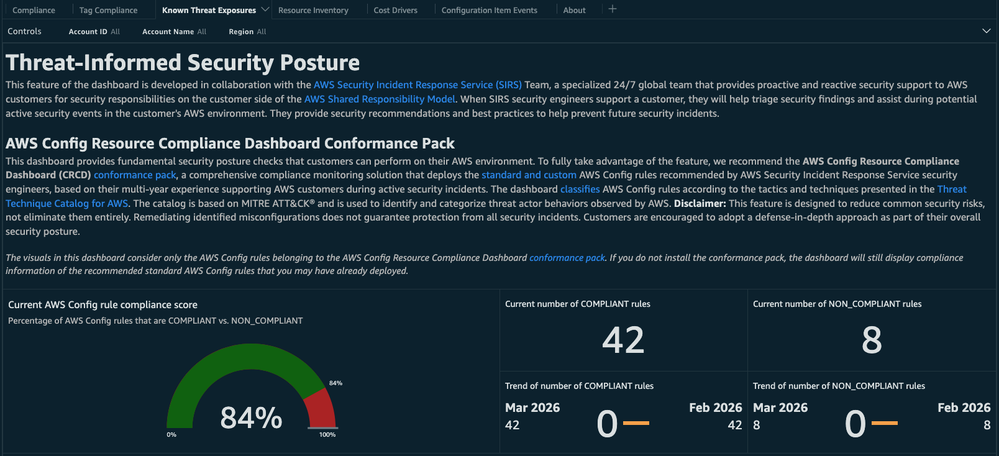

# Threat-Informed Security Posture with AWS Security Incident Response

The [AWS Security Incident Response](https://aws.amazon.com/security-incident-response/) team is a specialized 24/7 global team that provides proactive and reactive security support to AWS customers for security responsibilities on the customer side of the [AWS Shared Responsibility Model](https://aws.amazon.com/compliance/shared-responsibility-model/). When AWS Security Incident Response security engineers support a customer, they help triage security findings and assist during potential active security events in the customer's AWS environment. They provide security recommendations and best practices to help prevent future security incidents.

This feature of the AWS Config Dashboard was developed in collaboration with AWS Security Incident Response security experts, drawing on their multi-year experience supporting AWS customers during active security incidents. It uses AWS Config rules recommended by security engineers to identify preventable, common misconfigurations that are known to create vulnerabilities exploited in attacks against AWS environments. Addressing these misconfigurations helps eliminate the low-hanging fruit that bad actors frequently target when attempting to gain unauthorized access.

### Why this pack

- **Curated by incident responders**: Rules are selected based on multi-year experience supporting AWS customers during active security incidents — not from a theoretical compliance checklist.
- **Low cost, high impact**: Unlike larger conformance packs that may contain 50+ rules mapped to a compliance framework, this pack is intentionally small and focused. A small number of rules keeps AWS Config costs low and avoids the complexity of deploying dozens of rules, while still covering the misconfigurations most frequently exploited in real attacks.
- **Accessible to beginners**: Customers who are new to AWS security can deploy this pack to immediately gain visibility into their most critical exposures without needing deep security expertise. That said, any customer can deploy it to perform fundamental security posture checks, regardless of their experience level.
- **Threat-informed**: Rules are organized by threat-oriented category rather than by AWS service, helping customers understand *why* a misconfiguration matters in terms of what an attacker would do with it.
- **Dashboard integration**: This conformance pack can optionally be visualized in the [AWS Config Resource Compliance Dashboard (CRCD)](https://docs.aws.amazon.com/guidance/latest/cloud-intelligence-dashboards/config-resource-compliance-dashboard.html), which provides a QuickSight-based view of compliance status classified by threat-technique categories.

**Please note:** Resolving these misconfigurations significantly reduces your attack surface, but does not guarantee complete protection against security incidents. Additional security controls, monitoring, and practices are recommended as part of a comprehensive security strategy.

## Conformance Pack: Threat-Informed Security Best Practices (Fundamental)
The _Threat-Informed Security Best Practices (Fundamental)_ conformance pack is a comprehensive compliance monitoring solution that deploys the AWS Config rules recommended by Security Incident Response Service security engineers.

The **Threat-Informed Security Compliance** tab will display compliance status of the [standard and custom AWS Config rules](./crcd-conformance-pack-specification.md) in the conformance pack. The dashboard classifies AWS Config rules according to the tactics and techniques presented in the [Threat Technique Catalog for AWS](https://aws-samples.github.io/threat-technique-catalog-for-aws/). The catalog is based on MITRE ATT&CK® and is used to identify and categorize threat actor behaviors observed by AWS. This classification is intended to help you reason about *why* a misconfiguration matters in terms of attacker behavior — it is not a claim that the pack fully covers, maps to, or conforms to the catalog or MITRE ATT&CK. If you do not install the conformance pack, the dashboard will still display compliance of the [recommended standard AWS Config rules](./crcd-conformance-pack-specification.md) that you may have already deployed.

### Features
- **Recommended Rules**: Includes standard AWS Config managed rules and custom Lambda-based rules recommended by AWS Security Incident Response security engineers.
- **Threat Technique Catalog Classification**: Each rule is classified according to the Threat Technique Catalog for AWS (based on MITRE ATT&CK®).
- **Flexible Deployment**: Supports both AWS Organizations (organization-wide deployment) and standalone AWS accounts.
- **Multi-Region Support**: Deploys across all AWS Regions where AWS Config is enabled.
- **Automatic Updates**: In case of organization-wide deployment, new accounts joining the AWS Organization automatically receive the conformance pack.

## Architecture

### Deployment Modes

#### Organization-Wide Deployment
- Deploy from Management account or delegated administrator.
- Uses CloudFormation StackSets with automatic deployment enabled.
- Deploys to all accounts and Regions automatically.
- New accounts receive the conformance pack automatically via StackSet configuration.

#### Standalone Account Deployment
- Uses the same template as above, tailored to deploy the conformance pack in a single account.
- Deploys in all Regions of the account.

### Conformance Pack Composition
The solution deploys two conformance packs:

- **Threat-Informed Security Best Practices (Fundamental)** containing all standard AWS Config rules deployed in all Regions and all accounts of your organization.
- **Threat-Informed Security Best Practices (Fundamental) Extended** containing all rules that apply to AWS Identity and Access Management (IAM) resources, including the custom rules. Since IAM resources are global, these rules can be deployed on one Region to avoid redundancy and optimize cost.

The conformance packs support all parameters exposed by standard AWS Config rules and manages automatically regional availability of rules - i.e. you can deploy the conformance pack in all Regions where AWS Config is enabled, and if a rule is not available in a Region, it will be automatically skipped.

### Other ways to deploy
- The conformance pack is also provided by the AWS Config service and is [documented in the AWS Config developer guide](https://docs.aws.amazon.com/config/latest/developerguide/threat-informed-security-best-practices-fundamental.html). You can deploy that same conformance pack from the AWS Config console (selecting it as a sample template) or by handling its YAML templates directly with the AWS CLI or CloudFormation.
- See the [AWS Config provided templates README](./aws-provided-template/README.md) for those instructions, including the console deployment steps and their caveats (for example, the console path deploys the base template to the current account and Region only).

## Prerequisites

### Any deployment mode:
- **AWS Config**: Must be enabled in target accounts and Regions.

### Organization-Wide Deployment:
- **Service-Managed StackSets**: [Enable trusted access](https://docs.aws.amazon.com/organizations/latest/userguide/services-that-can-integrate-cloudformation.html#integrate-enable-ta-cloudformation) for CloudFormation StackSets in AWS Organizations.
- Deploy from an account designated as the delegated administrator of both [AWS CloudFormation](https://docs.aws.amazon.com/AWSCloudFormation/latest/UserGuide/stacksets-orgs-delegated-admin.html) and [AWS Config](https://docs.aws.amazon.com/config/latest/developerguide/aggregated-register-delegated-administrator.html) (recommended), or from the payer account of your organization.

# Deploy Instructions

## Step 1
1. Log into the AWS Management Console for your account or delegated admin for AWS CloudFormation and AWS Config of your organization.
1. Select a Region that will be the base Region for your deployment and where you will deploy the extended version of your conformance pack.
1. Click the Launch Stack button below to open the stack [template](https://console.aws.amazon.com/cloudformation/home#/stacks/create/review?&templateURL=https://aws-managed-cost-intelligence-dashboards.s3.amazonaws.com/cfn/crcd-conformance-pack-stack.yaml&stackName=crcd-threat-informed-conformance-pack) in your CloudFormation console. 

[ conformance pack')](https://console.aws.amazon.com/cloudformation/home#/stacks/create/review?&templateURL=https://aws-managed-cost-intelligence-dashboards.s3.amazonaws.com/cfn/crcd-conformance-pack-stack.yaml&stackName=crcd-threat-informed-conformance-pack)

4. Specify the following parameters:
   - `Deployment mode` Choose deployment mode: `AWS Organizations` for organization-wide deployment (all accounts and Regions), or `Standalone` for single-account, multi-region deployment.
   - `Deployment account type` Choose type of deployment account (the current account). Select `Delegated Admin` if this account is the AWS Config and AWS CloudFormation delegated admin, or `Management Account` if you run this template from the management account of your AWS Organization. This parameter is used only when deployment mode is `AWS Organizations`.
   - `Target Organization Root or Organizational Unit IDs` Enter the root OU ID (`r-xxxx`) to deploy to all accounts of your organization, or specify a comma-separated list of Organizational Unit IDs (`ou-xxxx-xxxxxxxx`) to deploy to. This parameter is used only when deployment mode is `AWS Organizations`.
   - `Accounts to exclude` A comma-separated list of accounts that will not receive the organization conformance pack (leave empty to deploy to all accounts). **Make sure you add here any account ID where AWS Config is not enabled, otherwise the entire stack will fail**. This parameter is used only when deployment mode is `AWS Organizations`.
   - `Deployment Regions` Enter a comma-separated list of Regions where AWS Config is enabled and the conformance pack should be deployed. **Make sure you specify only AWS Regions where AWS Config is enabled in the accounts in scope, otherwise the entire stack will fail**.
1. Specify the parameters to the custom AWS Config rules in the following CloudFormation parameters:
   - `Root Account Not Used Regularly rule: root account usage threshold (days)` Custom rule `sire-ia-iam-iam-root-not-used-regularly` checks that the root user is not used regularly by looking when it was used last. This parameter specifies the number of days to look back for root account usage. If root was used within this threshold, the rule is marked NON_COMPLIANT.
1. Specify the parameters to the standard AWS Config rules in the following CloudFormation parameters. Follow the provided links for documentation of what these parameters are:
   - Parameter of rule [S3_BUCKET_LEVEL_PUBLIC_ACCESS_PROHIBITED](https://docs.aws.amazon.com/config/latest/developerguide/s3-bucket-level-public-access-prohibited.html):
     - `S3 Bucket-Level Public Access Prohibited rule: excluded public buckets`
   - Parameter of rule [S3_ACCESS_POINT_PUBLIC_ACCESS_BLOCKS](https://docs.aws.amazon.com/config/latest/developerguide/s3-access-point-public-access-blocks.html):
     - `S3 Access Point Public Access Block rule: excluded access points`
   - Parameters of rule [S3_ACCOUNT_LEVEL_PUBLIC_ACCESS_BLOCKS_PERIODIC](https://docs.aws.amazon.com/config/latest/developerguide/s3-account-level-public-access-blocks-periodic.html):
     - `S3 Account-Level Public Access Block rule: enforce option IgnorePublicAcls`
     - `S3 Account-Level Public Access Block rule: enforce option BlockPublicPolicy`
     - `S3 Account-Level Public Access Block rule: enforce option BlockPublicAcls`
     - `S3 Account-Level Public Access Block rule: enforce option RestrictPublicBuckets`
   - Parameters of rule [VPC_SG_PORT_RESTRICTION_CHECK](https://docs.aws.amazon.com/config/latest/developerguide/vpc-sg-port-restriction-check.html):
     - `VPC Security Group Port Restriction Check rule: restricted ports`
     - `VPC Security Group Port Restriction Check rule: protocol type`
     - `VPC Security Group Port Restriction Check rule: exclude external security groups`
     - `VPC Security Group Port Restriction Check rule: IP type`
1. Leave all other parameters at their default value.
1. Run the CloudFormation template.

# Update Instructions

To update the parameters of the AWS Config rules of the template open the CloudFormation stack in the main Region and update the stack. Changes propagate automatically to all accounts and Regions.

# Recommended Security Monitoring (Optional)

This solution creates an S3 bucket that stores the conformance pack template, along with Lambda functions and IAM roles. These resources are protected by least-privilege permissions, and the S3 bucket has versioning enabled so any overwrite of the template is recoverable. As defense-in-depth, we recommend enabling the following detective controls in your account to alert on unexpected changes to these resources:

- **CloudTrail S3 data events**: By default, CloudTrail does not log object-level (read/write) access to S3. To capture modifications to the conformance pack template, add the solution's S3 bucket (`threat-informed-cpack-templates-*`) to the data event selectors of an existing [CloudTrail trail](https://docs.aws.amazon.com/awscloudtrail/latest/userguide/logging-data-events-with-cloudtrail.html). Using your existing organization or account trail avoids duplicate logging and cost. Note that after deployment the solution does not modify the template object, so no data events are expected during normal operation and no additional CloudTrail cost is anticipated — any recorded write to this object indicates an out-of-band change worth investigating.
- **CloudFormation drift detection**: Direct, out-of-band changes to the deployed Lambda code or IAM roles will not go through a stack update and can diverge from this template. Enable the AWS Config managed rule [`cloudformation-stack-drift-detection-check`](https://docs.aws.amazon.com/config/latest/developerguide/cloudformation-stack-drift-detection-check.html), or run [drift detection](https://docs.aws.amazon.com/AWSCloudFormation/latest/UserGuide/using-cfn-stack-drift.html) on the stack and StackSets periodically, to detect this drift.
- **Alerting**: Route the findings from the controls above to your security operations tooling (for example, an [Amazon EventBridge](https://docs.aws.amazon.com/eventbridge/latest/userguide/eb-what-is.html) rule targeting Amazon SNS or your ticketing system) so that detected changes trigger a response rather than a silent log entry.

These controls are account-level and operate outside this template, so they are not created by the stack. Enabling them is optional but recommended for environments where tamper detection of the deployed resources is required.

# FAQ

**Q: How is this pack different from other published conformance packs?**

Other conformance packs are organized by compliance framework (NIST, PCI, CIS) or AWS service (S3, EC2). They are comprehensive — often containing 50 to 100+ rules — and are designed for customers who need to demonstrate compliance with a specific standard. This pack takes a different approach: it is curated by AWS Security Incident Response engineers based on the misconfigurations they see most frequently exploited in real attacks. It is intentionally small, making it cost-effective and accessible to customers who are beginning their security journey on AWS. Rather than covering every possible check, it focuses on the specific vulnerabilities that threat actors target most often to gain initial access.

**Q: I already have other conformance packs deployed. Should I still use this one?**

Yes. This is the only conformance pack that contains the specific set of rules recommended by AWS Security Incident Response engineers, including custom Lambda-based rules that are not part of any other pack. Even if some of the managed rules overlap with a comprehensive pack you already run (e.g., CIS, NIST), the value here is in *how* the pack is built: a focused, incident-responder-curated selection of the misconfigurations most frequently exploited in real attacks, organized by threat-oriented category so you can reason about exposures in terms of attacker behavior. Deploying it alongside your existing packs adds that threat-informed lens — and the custom rules — without conflicting with what you already have.

**Q: Why do rule names have the `sire-` prefix?**

The rule naming convention (`sire-ia-{category}-{rule}`) encodes a threat-oriented category, which enables grouping and visualization on security dashboards. The prefix `sire` stands for **S**ecurity **I**ncident **R**esponse **E**ngineering. `ia` derives from "Initial Access" from MITRE ATT&CK; it indicates the intent behind the grouping rather than a formal mapping to the ATT&CK framework.

The `sire-` prefix indicates that the rules originate from the AWS Security Incident Response team, whose engineers selected the rules based on misconfigurations observed during real security incidents.

# References
- [Threat Technique Catalog for AWS](https://aws-samples.github.io/threat-technique-catalog-for-aws/).
- [MITRE ATT&CK® Framework](https://attack.mitre.org/).
- [AWS Config Rules](https://docs.aws.amazon.com/config/latest/developerguide/managed-rules-by-aws-config.html).
- [Threat-Informed Security Best Practices (Fundamental)](https://docs.aws.amazon.com/config/latest/developerguide/threat-informed-security-best-practices-fundamental.html) sample conformance pack in the AWS Config documentation.
- [AWS Security Incident Response service](https://aws.amazon.com/security-incident-response/).
- [AWS Config Conformance Packs](https://docs.aws.amazon.com/config/latest/developerguide/conformance-packs.html)
- [AWS Config Managed Rules by Region Availability](https://docs.aws.amazon.com/config/latest/developerguide/managing-rules-by-region-availability.html)
- [Specification of all AWS Config and custom rules](./crcd-conformance-pack-specification.md) that will be deployed as part of the conformance pack.
- [Cloud Formation template](./crcd-conformance-pack-stack.yaml) to deploy the conformance pack and the related AWS resources. 

