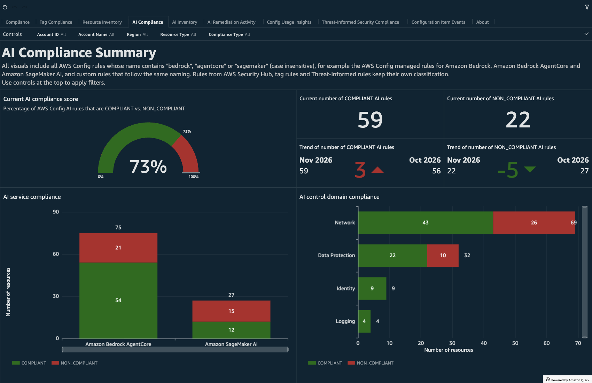
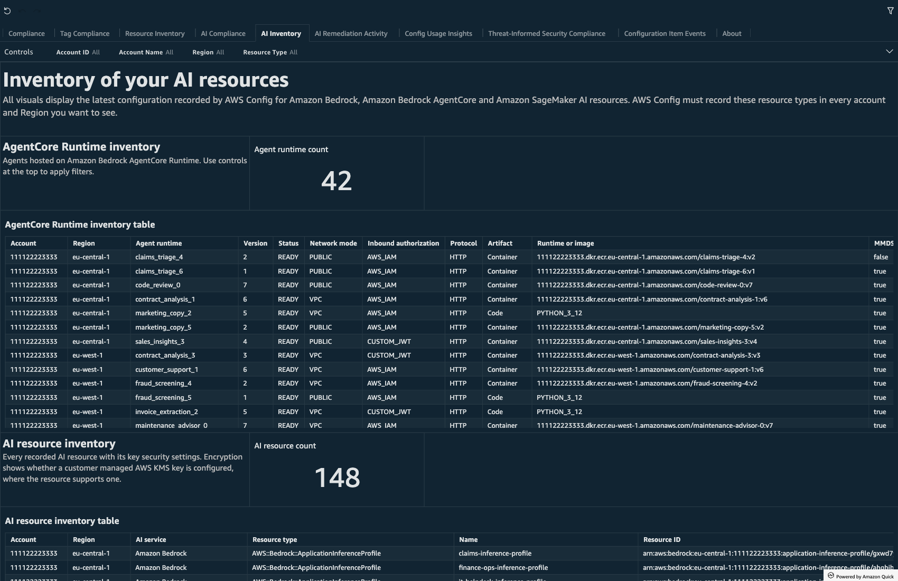
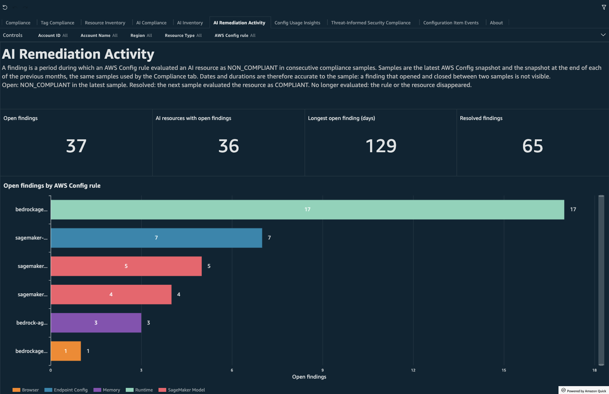

# AI Governance

The AI Governance tabs show the compliance and inventory of AI workloads on Amazon Bedrock, Amazon Bedrock AgentCore and Amazon SageMaker AI. They use the same AWS Config data, Athena table and refresh schedule as the rest of the dashboard. No additional data collection is required.

## Tabs

### AI Compliance

A deep dive on the compliance of AWS Config rules for AI services, with the same visual journey as **Tag Compliance**. The tab uses the `config_compliance` dataset and shows the rules whose classification `crcd-classification-lv1` is `AI Governance`. This includes every rule whose name contains `bedrock`, `agentcore` or `sagemaker` (case insensitive), except rules that already have another classification (AWS Security Hub, tag rules and Threat-Informed rules).

* **Current AI compliance score** and the number of COMPLIANT and NON_COMPLIANT AI rules, with the comparison to the end of the previous month.
* **AI service compliance**: resources evaluated by AI rules, grouped by Amazon Bedrock, Amazon Bedrock AgentCore and Amazon SageMaker AI.
* **AI control domain compliance**: the same resources grouped by `crcd-classification-lv2`: Network, Data Protection, Identity, Logging, Supply Chain, Guardrails and Configuration.
* **Evolution of AI compliance** and evolution of resource type compliance, on the latest snapshot and the end of the previous 5 months, like the other compliance tabs.
* Account, Region, AWS Config rule and resource type compliance, and the **AI compliance tracker** table.

### AI Inventory

The latest configuration of every AI resource recorded by AWS Config, with the same structure as **Resource Inventory**.

* **AgentCore Runtime inventory**: agents hosted on Amazon Bedrock AgentCore Runtime with version, status, network mode, inbound authorization (`AWS_IAM` or `CUSTOM_JWT`), protocol, artifact (container image or code runtime), MMDSv2 requirement, execution role and your four custom tags.
* **AI resource inventory**: every AI resource with the settings that matter for its governance, where the resource type has them: network mode, encryption (customer managed AWS KMS key or AWS owned key), AgentCore Gateway inbound authorization, policy engine mode and AWS WAF web ACL, browser session recording, memory event expiry, SageMaker AI network isolation and the models behind application inference profiles.
* Distribution of AI resources by type, account and Region; network mode of agents, tools and models; encryption by resource type; AgentCore Gateway policy enforcement.

### AI Remediation Activity

The lifecycle of findings on AI resources. A finding is a period during which an AWS Config rule evaluated a resource as NON_COMPLIANT in consecutive compliance samples. The samples are the ones used by the compliance tabs: the latest snapshot and the snapshot at the end of each of the previous 5 months. A resource that moves between COMPLIANT and NON_COMPLIANT produces one finding per NON_COMPLIANT period.

* Open findings, AI resources with open findings, longest open finding and resolved findings.
* Open findings by AWS Config rule, by age, by account; findings by status and AI service.
* Open findings and closed findings tables.

Finding status is `Open` (NON_COMPLIANT in the latest sample), `Resolved` (the next sample evaluated the resource as COMPLIANT) or `No longer evaluated` (the rule or the resource disappeared). Dates and durations are accurate to the sample: a finding that opened and closed between two samples is not visible, and ages are capped by the 5-month window.

The dashboard does not assign a severity or priority to findings. The tab is scoped to AI resource types with one filter group on the calculated field `ai-service`. Remove that filter group to show remediation activity for all AWS Config rules.

## Data sources

| View | Dataset | Content |
|------|---------|---------|
| `config_compliance` | `config_compliance` | Existing view, used by AI Compliance with the `crcd-classification-lv1` filter |
| `config_inventory_ai` | `config_inventory_ai` | Latest configuration of every Bedrock, AgentCore and SageMaker AI resource, with custom tags |
| `config_inventory_agents` | `config_inventory_agents` | Latest configuration of every AgentCore Runtime, with custom tags |
| `config_compliance_remediation` | `config_compliance_remediation` | Findings computed from `config_compliance` |

Calculated fields added in Quick Sight, so you can change them without editing the views:
* `crcd-classification-lv1`: new value `AI Governance`.
* `crcd-classification-lv2`: AI control domains, assigned only to AI rules.
* `ai-service`: AI service of the resource type (on `config_compliance`, `config_inventory_ai` and `config_compliance_remediation`).
* `ai-resource-type`: short resource type label for the AI charts.
* `finding-age-band`: age band of open findings.

AWS Config records AgentCore, Bedrock and SageMaker AI resources with the CloudFormation property names (`NetworkConfiguration.NetworkMode`, `RoleArn`, `KmsKeyArn`). The views read these exact paths; they were checked against configuration items recorded by AWS Config in November 2026.

## Prerequisites

1. **AWS Config recording** for the AI resource types you use: `AWS::Bedrock::Guardrail`, `AWS::Bedrock::KnowledgeBase`, `AWS::Bedrock::Prompt`, `AWS::Bedrock::ApplicationInferenceProfile`, `AWS::BedrockAgentCore::Runtime`, `AWS::BedrockAgentCore::Gateway`, `AWS::BedrockAgentCore::Memory`, `AWS::BedrockAgentCore::BrowserCustom`, `AWS::BedrockAgentCore::CodeInterpreterCustom`, `AWS::SageMaker::Model`, `AWS::SageMaker::EndpointConfig`. If you record a selected list of resource types, add `AWS::Config::ResourceCompliance` as well, like for every compliance tab of the dashboard.
2. **AWS Config rules for AI resources.** The compliance and remediation tabs show any rule that follows the naming above. The AWS Config managed rules for AgentCore are, for example, `bedrockagentcore-runtime-private-network-required`, `bedrockagentcore-gateway-authorizer-enabled`, `bedrockagentcore-gateway-encryption-enabled`, `bedrock-agentcore-memory-encryption-enabled`, `bedrock-agentcore-memory-event-expiry-duration`, `bedrockagentcore-browsercustom-network-mode-not-public`, `bedrockagentcore-browsercustom-recording-enabled` and `bedrockagentcore-codeinterpreter-networkmode-check`. See [AWS Config managed rules](https://docs.aws.amazon.com/config/latest/developerguide/managed-rules-by-aws-config.html) for the SageMaker AI and Bedrock rules. Managed rule availability varies by AWS Region.

If AWS Config records no AI resources, the AI tabs are empty. The rest of the dashboard is not affected.

## Upgrade

See [upgrade instructions](./upgrade.md).
